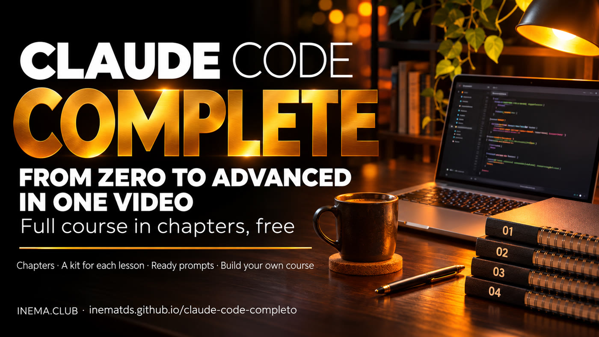

# claude-code-completo

**🇧🇷 [Português](README.md) · 🇺🇸 [English](README.en.md) · 🇪🇸 [Español](README.es.md)**

[](https://inematds.github.io/claude-code-completo/guia/en/)

## What it is

Claude Code is Anthropic’s AI assistant that works with files on your computer: it reads, writes, organizes, and runs tasks for you. This is a **complete course in chapters**, all in one free video, covering everything from the Claude overview to agents that prove what they do, work safely, and run on their own. Each chapter has a guide with step-by-step instructions and a prompt ready to copy. All you need to watch is a browser. The repository also includes the tool used to assemble this video, so you can combine your own short videos into a long course.

## 📖 User guide

Complete guide (course, chapters, and step-by-step instructions): **https://inematds.github.io/claude-code-completo/guia/en/**

🎓 Complete course on YouTube (33 min, 12 chapters): **https://www.youtube.com/watch?v=E5ZumaYjzT8**

## Watch the course

The catalog below comes from `curso/curso.json`. Click a title to watch the chapter or open its guide.

| Nº | Title | What you’ll learn | Guide |
| --- | --- | --- | --- |
| 1 | [The 25 parts of Claude](https://www.youtube.com/watch?v=eVt7RHdGObM) | The Claude overview for people who don’t code: models, projects, memory, connectors, skills, Cowork, and Claude Code, and what each plan unlocks. | [Open guide](https://inematds.github.io/claude-25-conceitos/guia/en/) |
| 2 | [Claude as an office](https://www.youtube.com/watch?v=_2CN3ef0HPU) | Documents, presentations, and design assets created with your branding, from a Project with the text “who I am” (most of it works even on the free plan). | [Open guide](https://inematds.github.io/claude-escritorio/guia/en/) |
| 3 | [13 new features in Claude Code](https://www.youtube.com/watch?v=-0c8o2AH2a8) | What Claude Code does on your computer and the most useful new features for people who don’t code: subagents, background tasks, panels, and more, with guidance for each one. | [Open guide](https://inematds.github.io/claude-code-2/guia/en/) |
| 4 | [Who used up your limit](https://www.youtube.com/watch?v=sYEEo7CnTys) | How to read the logs Claude Code and Codex already save on your computer to see which project or routine used up your subscription’s weekly limit. | [Open guide](https://inematds.github.io/medidor-de-limite/guia/en/) |
| 5 | [The 8 phrases that ask for proof](https://www.youtube.com/watch?v=MuERu0hBlfo) | Eight writing phrases that make AI show what it did (the file, the output, the test) instead of just saying “done,” in ChatGPT, Claude, or Gemini. | [Open guide](https://inematds.github.io/escrita-e-engenharia/guia/en/) |
| 6 | [Prompt with proof](https://www.youtube.com/watch?v=UpVrAp4B9oo) | A request template where the agent can only say “done” when it has proof in hand, and a checker that scores your request from 0 to 8. | [Open guide](https://inematds.github.io/escrita-e-engenharia/guia/en/) |
| 7 | [The agent that learns from mistakes](https://www.youtube.com/watch?v=l-D13_QGtHk) | The steps to help an agent stop repeating the same mistake: record the failure, separate request errors from machine errors, and turn the lesson into an automatic safeguard. | [Open guide](https://inematds.github.io/agente-que-aprende/guia/en/) |
| 8 | [Rebuild an app by asking for proof](https://www.youtube.com/watch?v=ROqRYAlKpNY) | The 4 rules for having an agent study an app and make its own version without inventing anything it hasn’t seen, with a proof file that a checker rejects if proof is missing. | [Open guide](https://inematds.github.io/rea-com-provas/guia/en/) |
| 9 | [The agent’s box](https://www.youtube.com/watch?v=PiBmzECMBrk) | Why an agent can read your passwords and how to make it work in a disposable box, without a network connection or your secret files. | [Open guide](https://inematds.github.io/caixa-do-agente/guia/en/) |
| 10 | [Your repositories, safe](https://www.youtube.com/watch?v=CGzG8-GJohs) | A three-layer setup to keep from losing your code if your account is blocked: a copy with another company, dated snapshots on your own drive, and, if you want, your own server. | [Open guide](https://inematds.github.io/protegendo-seus-repos/guia/en/) |
| 11 | [A team of bots through your subscription](https://www.youtube.com/watch?v=lA9BHfoVZDo) | A bot dashboard with names, roles, memory, and scheduled tasks, powered by the Claude or Codex subscription you already pay for, with no API key. | [Open guide](https://inematds.github.io/time-de-bots/guia/en/) |
| 12 | [The dashboard for your bots](https://www.youtube.com/watch?v=ViFzEStl0Ak) | One screen that shows what your automated routines did overnight, who failed, and what’s waiting for you, read aloud in Portuguese. | [Open guide](https://inematds.github.io/jarvis-painel/guia/en/) |

## Build your own long course

Prerequisites: Python 3.10 or later, ffmpeg (with ffprobe on PATH), and Pillow. In a Python environment with these dependencies available, run:

```bash
python3 -m pip install -r requirements.txt
python3 ferramentas/videos_de_teste.py   # cria 3 vídeos de teste em exemplos/videos/
python3 ferramentas/montar_curso.py exemplos/meu-curso.json --saida saida/curso.mp4
```

Before running, edit `exemplos/meu-curso.json` with your titles and files. The example videos should be placed in `exemplos/videos/`; paths are relative to the JSON file and accept `~`. The real videos in the catalog are not included in the repository.

The input accepts an object with `titulo`, `capitulos`, `descricao_topo`, and `descricao_fim` (descriptions are optional), or a plain list of chapters. Each chapter needs `arquivo` and `titulo`; extra fields are ignored. To use YAML, optionally install `pyyaml`.

```bash
# Só estima os tempos e gera os textos, sem renderizar.
python3 ferramentas/montar_curso.py exemplos/meu-curso.json --saida saida/curso.mp4 --so-capitulos
# Ajusta o cartão, a resolução e a taxa de quadros.
python3 ferramentas/montar_curso.py exemplos/meu-curso.json --saida saida/curso.mp4 --cartao-s 3 --largura 1920 --altura 1080 --fps 30
```

The output includes `saida/curso.mp4`, `saida/curso-capitulos.txt`, and `saida/curso-descricao.txt`. Each chapter starts with its title card. Audio is normalized, videos without audio receive silence, and the original aspect ratio is preserved with borders. The final duration is checked against the converted segments, with a tolerance of 1 second. In `--so-capitulos` mode, success means only that the estimated text files were generated.

Use `--manter-temp` to preserve title cards and segments; the path will be printed. Without this option, temporary files are removed. The program warns when there are fewer than three chapters or chapters shorter than ten seconds, in accordance with YouTube’s rules.

## Tests

With pytest installed (`python3 -m pip install pytest`), run:

```bash
python3 -m pytest -q
```

The tests create only temporary synthetic videos. Without ffmpeg or ffprobe, they are skipped with a message; the YAML case is skipped if PyYAML is unavailable.

## License

Code under the MIT License, Copyright 2026 INEMA: see [LICENSE](LICENSE).
The Sora font is under OFL: see [ferramentas/fontes/OFL.txt](ferramentas/fontes/OFL.txt).
