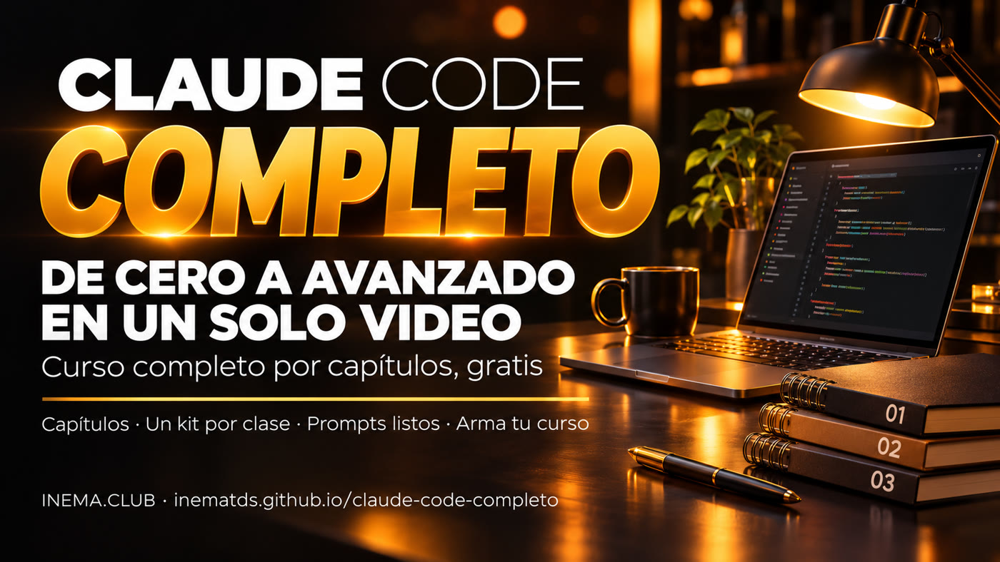

# claude-code-completo

**🇧🇷 [Português](README.md) · 🇺🇸 [English](README.en.md) · 🇪🇸 [Español](README.es.md)**

[](https://inematds.github.io/claude-code-completo/guia/es/)

## Qué es

Claude Code es el asistente de IA de Anthropic que trabaja con los archivos de tu computadora: los lee, escribe, organiza y realiza tareas por ti. Este es un **curso completo por capítulos**, en un solo video y gratis, que va desde el mapa de Claude hasta agentes que demuestran lo que hacen, trabajan con seguridad y funcionan por su cuenta. Cada capítulo tiene una guía con el paso a paso y un prompt listo para copiar. Para verlo, solo necesitas el navegador. El repositorio también incluye la herramienta que armó este video, para que puedas unir tus propios videos cortos en un curso largo.

## 📖 Guía de uso

Guía completa (curso, capítulos y paso a paso): **https://inematds.github.io/claude-code-completo/guia/es/**

🎓 Curso completo en YouTube (33 min, 12 capítulos): **https://www.youtube.com/watch?v=E5ZumaYjzT8**

## Ver el curso

El catálogo de abajo proviene de `curso/curso.json`. Haz clic en el título para ver el capítulo o abrir su guía.

| Nº | Título | Qué se aprende | Guía |
| --- | --- | --- | --- |
| 1 | [Las 25 piezas de Claude](https://www.youtube.com/watch?v=eVt7RHdGObM) | El mapa de Claude para quienes no programan: los modelos, los proyectos, la memoria, los conectores, las skills, Cowork y Claude Code, y lo que ofrece cada plan. | [Abrir guía](https://inematds.github.io/claude-25-conceitos/guia/es/) |
| 2 | [Claude como oficina](https://www.youtube.com/watch?v=_2CN3ef0HPU) | Documentos, presentaciones y piezas de diseño con tu marca, a partir de un Proyecto con el texto «quién soy» (la mayoría funciona incluso con el plan gratis). | [Abrir guía](https://inematds.github.io/claude-escritorio/guia/es/) |
| 3 | [13 novedades de Claude Code](https://www.youtube.com/watch?v=-0c8o2AH2a8) | Qué hace Claude Code en tu computadora y las novedades más útiles para quienes no programan: subagentes, tareas en segundo plano, paneles y más, con las precauciones para cada una. | [Abrir guía](https://inematds.github.io/claude-code-2/guia/es/) |
| 4 | [Quién consumió tu límite](https://www.youtube.com/watch?v=sYEEo7CnTys) | Cómo leer los registros que Claude Code y Codex ya guardan en tu computadora para ver qué proyecto o rutina consumió el límite semanal de tu suscripción. | [Abrir guía](https://inematds.github.io/medidor-de-limite/guia/es/) |
| 5 | [Las 8 frases que piden pruebas](https://www.youtube.com/watch?v=MuERu0hBlfo) | Ocho frases de escritura que hacen que la IA muestre lo que hizo (el archivo, el resultado, la prueba) en vez de solo decir «listo», en ChatGPT, Claude o Gemini. | [Abrir guía](https://inematds.github.io/escrita-e-engenharia/guia/es/) |
| 6 | [Prompt con pruebas](https://www.youtube.com/watch?v=UpVrAp4B9oo) | El modelo de solicitud en el que el agente solo puede decir «listo» con la prueba en mano, y el verificador que califica tu solicitud de 0 a 8. | [Abrir guía](https://inematds.github.io/escrita-e-engenharia/guia/es/) |
| 7 | [El agente que aprende de sus errores](https://www.youtube.com/watch?v=l-D13_QGtHk) | Los pasos para que el agente deje de repetir el mismo error: registrar la falla, distinguir entre un error de la solicitud y uno de la máquina, y convertir la lección en un bloqueo automático. | [Abrir guía](https://inematds.github.io/agente-que-aprende/guia/es/) |
| 8 | [Rehacer una app pidiendo pruebas](https://www.youtube.com/watch?v=ROqRYAlKpNY) | Las 4 reglas para que el agente estudie una app y haga su propia versión sin inventar lo que no vio, con un archivo de pruebas que un verificador rechaza cuando faltan pruebas. | [Abrir guía](https://inematds.github.io/rea-com-provas/guia/es/) |
| 9 | [La caja del agente](https://www.youtube.com/watch?v=PiBmzECMBrk) | Por qué el agente puede leer tus contraseñas y cómo hacerlo trabajar en una caja desechable, sin red ni tus archivos secretos. | [Abrir guía](https://inematds.github.io/caixa-do-agente/guia/es/) |
| 10 | [Tus repositorios a salvo](https://www.youtube.com/watch?v=CGzG8-GJohs) | El diseño en tres capas para no perder tu código si bloquean tu cuenta: una copia en otra empresa, fotos fechadas en un disco tuyo y, si quieres, un servidor propio. | [Abrir guía](https://inematds.github.io/protegendo-seus-repos/guia/es/) |
| 11 | [Equipo de bots con tu suscripción](https://www.youtube.com/watch?v=lA9BHfoVZDo) | Un panel de bots con nombre, rol, memoria y tareas programadas, que responden con la suscripción de Claude o Codex que ya pagas, sin clave de API. | [Abrir guía](https://inematds.github.io/time-de-bots/guia/es/) |
| 12 | [El panel de tus robots](https://www.youtube.com/watch?v=ViFzEStl0Ak) | Una sola pantalla que muestra lo que hicieron tus rutinas automáticas durante la madrugada, quién falló y qué te espera, leída en voz alta en portugués. | [Abrir guía](https://inematds.github.io/jarvis-painel/guia/es/) |

## Armar tu curso largo

Requisitos: Python 3.10 o superior, ffmpeg (con ffprobe en el PATH) y Pillow. En un entorno Python con estas dependencias disponibles, ejecuta:

```bash
python3 -m pip install -r requirements.txt
python3 ferramentas/videos_de_teste.py   # crea 3 videos de prueba en ejemplos/videos/
python3 ferramentas/montar_curso.py exemplos/meu-curso.json --saida saida/curso.mp4
```

Antes de ejecutar, edita `exemplos/meu-curso.json` con tus títulos y archivos. Los videos del ejemplo deben estar en `exemplos/videos/`; las rutas son relativas al archivo JSON y aceptan `~`. Los videos reales del catálogo no están incluidos en el repositorio.

La entrada acepta un objeto con `titulo`, `capitulos`, `descricao_topo` y `descricao_fim` (las descripciones son opcionales), o una lista simple de capítulos. Cada capítulo necesita `arquivo` y `titulo`; los campos adicionales se ignoran. Para YAML, instala `pyyaml` de forma opcional.

```bash
# Solo calcula los tiempos y genera los textos, sin renderizar.
python3 ferramentas/montar_curso.py exemplos/meu-curso.json --saida saida/curso.mp4 --so-capitulos
# Ajusta la tarjeta, la resolución y la velocidad de fotogramas.
python3 ferramentas/montar_curso.py exemplos/meu-curso.json --saida saida/curso.mp4 --cartao-s 3 --largura 1920 --altura 1080 --fps 30
```

La salida incluye `saida/curso.mp4`, `saida/curso-capitulos.txt` y `saida/curso-descricao.txt`. Cada capítulo empieza con su tarjeta. El audio se normaliza, los videos sin audio reciben silencio y se preserva la proporción original con bordes. La duración final se verifica con los segmentos convertidos, con una tolerancia de 1 segundo. En el modo `--so-capitulos`, el éxito significa únicamente que se generaron los textos estimados.

Usa `--manter-temp` para conservar las tarjetas y los segmentos; se imprimirá la ruta. Sin esta opción, se eliminan los archivos temporales. El programa avisa cuando hay menos de tres capítulos o capítulos de menos de diez segundos, según las reglas de YouTube.

## Pruebas

Con pytest instalado (`python3 -m pip install pytest`), ejecuta:

```bash
python3 -m pytest -q
```

Las pruebas crean únicamente videos sintéticos temporales. Si no está disponible ffmpeg o ffprobe, se omiten con un mensaje; el caso YAML se omite si PyYAML no está disponible.

## Licencia

El código está bajo la licencia MIT, Copyright 2026 INEMA: consulta [LICENSE](LICENSE).
La fuente Sora está bajo OFL: consulta [ferramentas/fontes/OFL.txt](ferramentas/fontes/OFL.txt).
