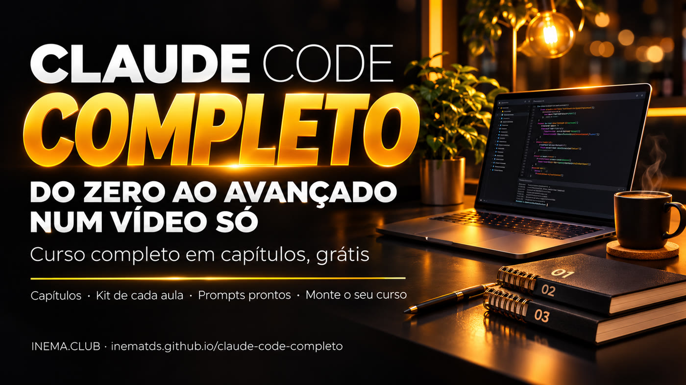

# claude-code-completo

**🇧🇷 [Português](README.md) · 🇺🇸 [English](README.en.md) · 🇪🇸 [Español](README.es.md)**

[](https://inematds.github.io/claude-code-completo/guia/)

## O que é

O Claude Code é o assistente de IA da Anthropic que trabalha nos arquivos do seu computador: lê, escreve, organiza e roda tarefas por você. Este é um **curso completo em capítulos**, num vídeo só e grátis, que vai do mapa do Claude até agentes que provam o que fazem, trabalham com segurança e rodam sozinhos. Cada capítulo tem um guia com o passo a passo e um prompt pronto para copiar. Para assistir, basta o navegador. O repositório traz também a ferramenta que montou este vídeo, para você juntar os seus próprios vídeos curtos num curso longo.

## 📖 Guia de uso

Guia completo (curso, capítulos e passo a passo): **https://inematds.github.io/claude-code-completo/guia/**

🎓 Curso completo no YouTube (33 min, 12 capítulos): **https://www.youtube.com/watch?v=E5ZumaYjzT8**

## Assistir o curso

O catálogo abaixo vem de `curso/curso.json`. Clique no título para assistir ao capítulo ou abra seu guia.

| Nº | Título | O que se aprende | Guia |
| --- | --- | --- | --- |
| 1 | [As 25 peças do Claude](https://www.youtube.com/watch?v=eVt7RHdGObM) | O mapa do Claude para quem não programa: os modelos, os projetos, a memória, os conectores, as skills, o Cowork e o Claude Code, e o que cada plano libera. | [Abrir guia](https://inematds.github.io/claude-25-conceitos/guia/) |
| 2 | [O Claude como escritório](https://www.youtube.com/watch?v=_2CN3ef0HPU) | Documentos, apresentações e peças de design saindo com a sua marca, a partir de um Projeto com o texto "quem eu sou" (a maior parte funciona até no plano grátis). | [Abrir guia](https://inematds.github.io/claude-escritorio/guia/) |
| 3 | [13 novidades do Claude Code](https://www.youtube.com/watch?v=-0c8o2AH2a8) | O que o Claude Code faz no seu computador e as novidades mais úteis para quem não programa: subagentes, tarefas em segundo plano, painéis e mais, com o cuidado de cada uma. | [Abrir guia](https://inematds.github.io/claude-code-2/guia/) |
| 4 | [Quem comeu o seu limite](https://www.youtube.com/watch?v=sYEEo7CnTys) | Como ler os registros que o Claude Code e o Codex já gravam no seu computador para ver qual projeto ou rotina gastou o limite da semana da sua assinatura. | [Abrir guia](https://inematds.github.io/medidor-de-limite/guia/) |
| 5 | [As 8 frases que pedem prova](https://www.youtube.com/watch?v=MuERu0hBlfo) | Oito frases de escrita que fazem a IA mostrar o que fez (o arquivo, a saída, o teste) em vez de só dizer "pronto", no ChatGPT, no Claude ou no Gemini. | [Abrir guia](https://inematds.github.io/escrita-e-engenharia/guia/) |
| 6 | [Prompt com prova](https://www.youtube.com/watch?v=UpVrAp4B9oo) | O modelo de pedido em que o agente só pode dizer "pronto" com a prova na mão, e o checador que dá nota de 0 a 8 ao seu pedido. | [Abrir guia](https://inematds.github.io/escrita-e-engenharia/guia/) |
| 7 | [O agente que aprende com o erro](https://www.youtube.com/watch?v=l-D13_QGtHk) | Os degraus para o agente parar de repetir o mesmo erro: anotar a falha, separar erro de pedido de erro de máquina e transformar a lição numa trava automática. | [Abrir guia](https://inematds.github.io/agente-que-aprende/guia/) |
| 8 | [Refazer um app pedindo prova](https://www.youtube.com/watch?v=ROqRYAlKpNY) | As 4 regras para o agente estudar um app e fazer a sua versão sem inventar o que não viu, com um arquivo de provas que um conferidor reprova quando falta prova. | [Abrir guia](https://inematds.github.io/rea-com-provas/guia/) |
| 9 | [A caixa do agente](https://www.youtube.com/watch?v=PiBmzECMBrk) | Por que o agente consegue ler as suas senhas e como fazê-lo trabalhar numa caixa descartável, sem rede e sem os seus arquivos de segredo. | [Abrir guia](https://inematds.github.io/caixa-do-agente/guia/) |
| 10 | [Seus repositórios a salvo](https://www.youtube.com/watch?v=CGzG8-GJohs) | O desenho em três camadas para não perder o seu código se a conta for bloqueada: cópia em outra empresa, fotos datadas num disco seu e, se quiser, um servidor próprio. | [Abrir guia](https://inematds.github.io/protegendo-seus-repos/guia/) |
| 11 | [Time de bots pela assinatura](https://www.youtube.com/watch?v=lA9BHfoVZDo) | Um painel de bots com nome, papel, memória e tarefas agendadas, respondendo pela assinatura do Claude ou do Codex que você já paga, sem chave de API. | [Abrir guia](https://inematds.github.io/time-de-bots/guia/) |
| 12 | [O painel dos seus robôs](https://www.youtube.com/watch?v=ViFzEStl0Ak) | Uma tela única que mostra o que as suas rotinas automáticas fizeram de madrugada, quem falhou e o que espera por você, lida em voz alta em português. | [Abrir guia](https://inematds.github.io/jarvis-painel/guia/) |

## Montar o seu curso longo

Pré-requisitos: Python 3.10 ou superior, ffmpeg (com ffprobe no PATH) e Pillow. Em um ambiente Python com essas dependências disponíveis, rode:

```bash
python3 -m venv .venv && source .venv/bin/activate   # ambiente só do kit
pip install -r requirements.txt
python3 ferramentas/videos_de_teste.py   # cria 3 vídeos de teste em exemplos/videos/
python3 ferramentas/montar_curso.py exemplos/meu-curso.json --saida saida/curso.mp4
```

Antes de rodar, edite `exemplos/meu-curso.json` com seus títulos e arquivos. Os vídeos do exemplo devem ficar em `exemplos/videos/`; os caminhos são relativos ao arquivo JSON e aceitam `~`. Os vídeos reais do catálogo não estão incluídos no repositório.

A entrada aceita um objeto com `titulo`, `capitulos`, `descricao_topo` e `descricao_fim` (as descrições são opcionais), ou uma lista pura de capítulos. Cada capítulo precisa de `arquivo` e `titulo`; campos extras são ignorados. Para YAML, instale opcionalmente `pyyaml`.

```bash
# Só estima os tempos e gera os textos, sem renderizar.
python3 ferramentas/montar_curso.py exemplos/meu-curso.json --saida saida/curso.mp4 --so-capitulos
# Ajusta o cartão, a resolução e a taxa de quadros.
python3 ferramentas/montar_curso.py exemplos/meu-curso.json --saida saida/curso.mp4 --cartao-s 3 --largura 1920 --altura 1080 --fps 30
```

A saída inclui `saida/curso.mp4`, `saida/curso-capitulos.txt` e `saida/curso-descricao.txt`. Cada capítulo começa no seu cartão. O áudio é normalizado, vídeos sem áudio recebem silêncio e a proporção original é preservada com bordas. A duração final é conferida contra os segmentos convertidos, com tolerância de 1 segundo. No modo `--so-capitulos`, sucesso significa apenas que os textos estimados foram gerados.

Use `--manter-temp` para preservar cartões e segmentos; o caminho será impresso. Sem essa opção, os temporários são removidos. O programa avisa quando há menos de três capítulos ou capítulos com menos de dez segundos, pelas regras do YouTube.

## Testes

Com pytest instalado (`python3 -m pip install pytest`), execute:

```bash
python3 -m pytest -q
```

Os testes criam somente vídeos sintéticos temporários. Sem ffmpeg ou ffprobe, são pulados com uma mensagem; o caso YAML é pulado se PyYAML não estiver disponível.

## Licença

Código sob a licença MIT, Copyright 2026 INEMA: veja [LICENSE](LICENSE).
A fonte Sora está sob OFL: veja [ferramentas/fontes/OFL.txt](ferramentas/fontes/OFL.txt).
